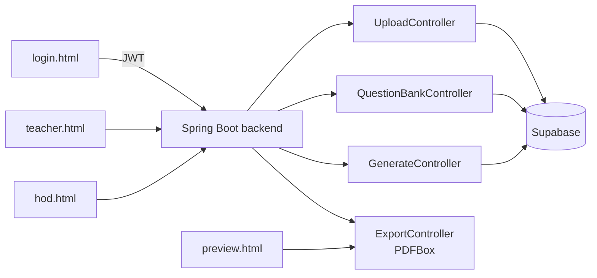

<div align="center">


</div>

## 📌 Overview

Setting an exam paper by hand means manually picking questions, checking the mark split and formatting a PDF every time. This tool lets a teacher upload a question bank, generate a paper from it with role-based login (Teacher / HOD), preview the result, and export it straight to PDF. The backend is a Spring Boot REST API secured with JWT and backed by Supabase; the frontend is a lightweight static HTML/JS app served by a plain Python script.

## ✨ Features

- 🔐 JWT-secured login with separate Teacher and HOD views
- 📤 Question bank upload (`UploadController`)
- 🗂️ Question bank browsing/management (`QuestionBankController`)
- 🧾 Exam paper generation from the stored question bank (`GenerateController`)
- 👀 Paper preview before export (`preview.html`)
- 📄 PDF export of the generated paper via Apache PDFBox (`ExportController`)
- ☁️ Supabase-backed storage accessed over REST via OkHttp
- 🧪 Dedicated `TestController` for backend sanity checks

## 🛠️ Tech Stack

| Layer | Technology |
|---|---|
| Backend |   |
| Auth |  JWT (jjwt) |
| PDF generation |  |
| Data |  via OkHttp REST calls |
| Frontend | HTML · CSS · JavaScript, served by a Python `http.server`-based `server.py` |

## 🏗️ Architecture



## 📂 Project Structure

```
exam_paper_generator/
├── backend/
│   ├── src/main/java/com/example/papergenerator/
│   │   ├── config/
│   │   ├── controller/
│   │   │   ├── UploadController.java
│   │   │   ├── QuestionBankController.java
│   │   │   ├── GenerateController.java
│   │   │   ├── ExportController.java
│   │   │   └── TestController.java
│   │   ├── model/
│   │   ├── service/
│   │   ├── util/
│   │   └── PaperGeneratorApplication.java
│   ├── .env
│   └── pom.xml
├── frontend/
│   ├── js/
│   ├── login.html
│   ├── teacher.html
│   ├── hod.html
│   ├── preview.html
│   └── server.py
└── requirements.txt
```

## ⚙️ Installation

```bash
git clone https://github.com/Fayaz-2007/exam_paper_generator.git
cd exam_paper_generator

# Backend (Java 17 + Maven)
cd backend
./mvnw spring-boot:run

# Frontend (second terminal) — standard-library only, no pip install needed
cd frontend
python server.py
```

### Environment variables

Set these in `backend/.env` (loaded via dotenv-java):

| Variable | Description |
|---|---|
| `SUPABASE_URL` | Supabase project URL used for question bank / paper storage |
| `SUPABASE_KEY` | Supabase project API key |
| `JWT_SECRET` | Secret used to sign/verify JWT login tokens |

## 🚀 Usage

1. Start the Spring Boot backend and the frontend's `server.py`.
2. Log in from `login.html` as a Teacher or HOD.
3. Upload a question bank, then generate a paper from it.
4. Preview the paper in `preview.html`.
5. Export the final paper as a PDF.

`[Screenshot: login screen]`

`[Screenshot: paper generation / preview screen]`

## 🔮 Future Improvements

- Replace the static HTML/JS frontend with a proper SPA framework
- Add difficulty-weighted and topic-weighted question selection
- Support multiple export formats (DOCX in addition to PDF)
- Add an approval workflow between Teacher-generated drafts and HOD sign-off
- Automated tests for the controller layer

## 👨‍💻 Author

**Fayaz Ahmed**
GitHub: [@Fayaz-2007](https://github.com/Fayaz-2007)
LinkedIn: [fayaz-ahmed-59287631a](https://linkedin.com/in/fayaz-ahmed-59287631a)

<div align="center">


</div>
